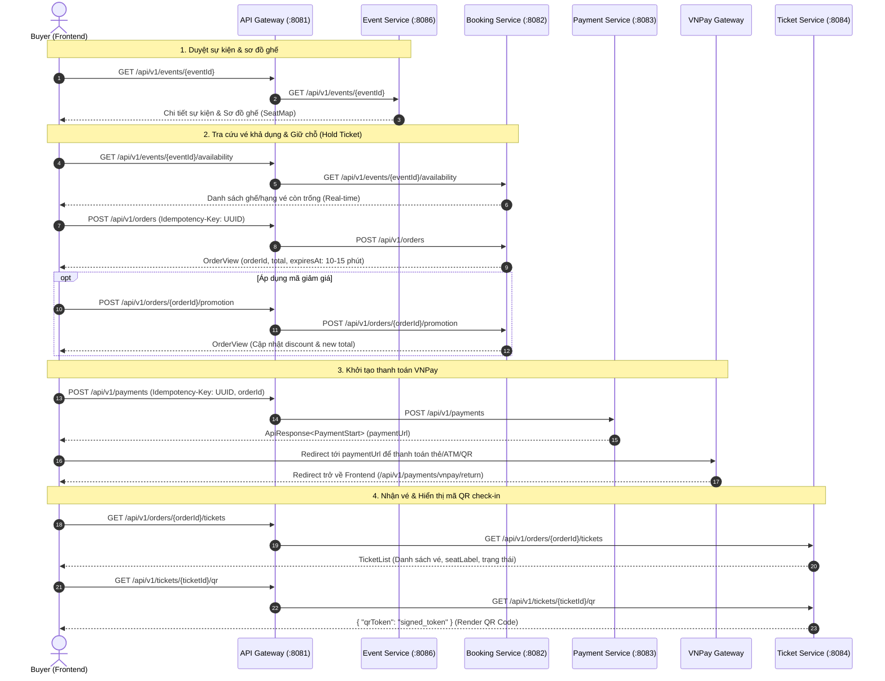

# FlashTicket - Tài Liệu Tích Hợp API Frontend (Toàn Bộ Microservices & Branches)

> **Mục tiêu**: Hướng dẫn chi tiết cho đội ngũ Frontend (FE) kết nối và tích hợp toàn bộ các REST API của nền tảng FlashTicket.  
> **Nguồn dữ liệu**: Tổng hợp từ việc rà soát toàn bộ source code trên các git branch: `main`, `dev/son`, `origin/dev/tuan`, `origin/dev/tuyen`, và các nhánh `codex/*`.

---

## 1. Tổng Quan Kiến Trúc & Thiết Lập Kết Nối (Connection & Security)

### 1.1. Địa chỉ kết nối (Base URL)
Toàn bộ các request từ Frontend đều **phải gửi qua API Gateway** (không gọi trực tiếp tới port nội bộ của từng service):
* **API Gateway Base URL**: `http://localhost:8081` (hoặc `http://127.0.0.1:18081` tùy file môi trường `.env`).
* **Keycloak URL**: `http://localhost:8080` (hoặc Server Dev `http://3.106.109.119:8080`).
  * Realm: `flash-ticket`
  * Client ID: `frontend` (PKCE OpenID Connect Public Client)

### 1.2. Phân Quyền & Headers Bắt Buộc
| Header | Giá trị / Ý nghĩa | Áp dụng |
| :--- | :--- | :--- |
| `Authorization` | `Bearer <access_token>` | Bắt buộc đối với các API cần xác thực |
| `Content-Type` | `application/json` (hoặc `multipart/form-data` khi upload ảnh) | Hầu hết các POST/PUT/PATCH |
| `Idempotency-Key` | Chuỗi UUID v4 (duy nhất cho mỗi phiên thao tác) | **Bắt buộc** với `POST /api/v1/orders`, `POST /api/v1/payments`, `POST .../ticket-deliveries`, `POST .../check-ins` |
| `X-Correlation-Id` | Chuỗi UUID tracking lỗi (tùy chọn, Gateway/Backend tự sinh nếu thiếu) | Dùng để truy vết log giữa Frontend và Backend |

### 1.3. Phân quyền người dùng (Roles trong Token JWT)
Gateway đọc trực tiếp mảng `realm_access.roles` từ Access Token:
* **Public**: Không cần token (`GET /api/v1/events/**`, `GET /api/v1/events/{id}/availability`, `GET /api/v1/organizers/{id}`).
* **ROLE_BUYER**: Người mua vé (`/api/v1/orders/**`, `/api/v1/payments/**`, `/api/v1/tickets/**`, `/api/v1/me`).
* **ROLE_ORGANIZER**: Nhà tổ chức (`/api/v1/organizer/**`, `/api/v1/events/{id}/check-ins`, `/api/v1/organizers/me/**`).
* **ROLE_ADMIN**: Quản trị viên hệ thống (`/api/v1/admin/**`).

### 1.4. Ma Trận Phân Bổ Code Trên Các Git Branch
| Service | Branch Có Mã Nguồn Đầy Đủ | Branch Scaffold / Đang Chờ Merge | Ghi Chú Tích Hợp Cho Frontend |
| :--- | :--- | :--- | :--- |
| **API Gateway** | `dev/son`, `origin/dev/tuan` | `main` | Định tuyến, Circuit Breaker, Rate Limit & CORS đã ổn định trên `dev/son`. |
| **Booking Service** | `dev/son`, `origin/dev/tuan`, `origin/dev/tuyen` | `main` | Cung cấp luồng tạo đơn vé, áp voucher, huỷ đơn, kiểm tra availability. |
| **Payment Service** | `dev/son`, `origin/dev/tuan` | `main` | Cung cấp luồng khởi tạo link thanh toán VNPay, IPN và kiểm tra trạng thái thanh toán. |
| **Ticket Service** | `origin/dev/tuan`, `origin/dev/tuyen` | `dev/son` (scaffold), `main` | Cung cấp xuất vé, dynamic QR Code, quét check-in và gửi lại email vé. |
| **Event Service** | `origin/dev/tuan`, `origin/dev/tuyen` | `dev/son` (scaffold), `main` | Cung cấp duyệt sự kiện, sơ đồ ghế seat map, upload ảnh sự kiện (`dev/tuyen`). |
| **User Service** | `origin/dev/tuan`, `origin/dev/tuyen` | `dev/son` (scaffold), `main` | Cung cấp thông tin profile, đăng ký đối tác Organizer, follow/unfollow. |

---

## 2. Chuẩn Dữ Liệu Phản Hồi & Xử Lý Lỗi (Error Contracts)

### 2.1. Chuẩn Báo Lỗi RFC 7807 (`Problem`)
Hầu hết các service (`booking-service`, `ticket-service`, `user-service`, `event-service`) trả lỗi dạng Problem chuẩn:
```json
{
  "code": "OUT_OF_STOCK",
  "message": "Vé đã được đặt hết hoặc bị khóa bởi giao dịch khác",
  "correlationId": "550e8400-e29b-41d4-a716-446655440000",
  "violations": [
    {
      "field": "selection.items[0].quantity",
      "code": "InsufficientAvailable"
    }
  ]
}
```

### 2.2. Chuẩn ApiResponse Bọc (`payment-service`)
Service thanh toán trả về đối tượng bọc `ApiResponse<T>`:
```json
{
  "success": true,
  "message": "Payment created successfully",
  "data": { ... }
}
```
Khi lỗi (`success: false`):
```json
{
  "success": false,
  "message": "Order is not in a payable state",
  "data": {
    "code": "INVALID_STATE",
    "message": "Order is not in a payable state",
    "correlationId": "550e8400-e29b-41d4-a716-446655440000",
    "violations": []
  }
}
```

---

## 3. Luồng Nghiệp Vụ Tích Hợp Frontend (Step-by-Step Business Flows)



---

## 4. Danh Mục Chi Tiết Toàn Bộ Endpoints Theo Service

---

### PHẦN I: BOOKING SERVICE (Quản lý Đặt Vé & Giữ Chỗ)
* **Port nội bộ**: `8082` | **Branch**: `dev/son`, `origin/dev/tuan`, `origin/dev/tuyen`
* **Route Prefix Gateway**: `/api/v1/events/*/availability`, `/api/v1/orders/**`

#### 1. Kiểm tra vé còn trống thời gian thực (Real-time Availability)
* **Method & Path**: `GET /api/v1/events/{eventId}/availability`
* **Auth**: Public (Không yêu cầu đăng nhập)
* **Path Variables**:
  * `eventId` (UUID): ID của sự kiện.
* **Success Response (200 OK)**:
```json
{
  "eventId": "3fa85f64-5717-4562-b3fc-2c963f66afa6",
  "sourceConfigVersion": "1",
  "asOf": "2026-11-04T13:45:30.123Z",
  "ticketTypes": [
    {
      "ticketTypeId": "9b1deb4d-3b7d-4bad-9bdd-2b0d7b3dcb6d",
      "available": "85"
    }
  ],
  "sectors": [
    {
      "sectorId": "1b9d6bcd-bbfd-4b2d-9b5d-ab8dfbbd4bed",
      "kind": "SEATED",
      "available": "50"
    }
  ],
  "seats": [
    {
      "seatId": "6ba7b810-9dad-11d1-80b4-00c04fd430c8",
      "state": "AVAILABLE" // AVAILABLE | LOCKED | SOLD
    }
  ]
}
```

#### 2. Tạo đơn đặt vé / Khóa vé (Create Order & Hold Tickets)
* **Method & Path**: `POST /api/v1/orders`
* **Auth**: Yêu cầu Role `ROLE_BUYER` (`Authorization: Bearer <token>`)
* **Headers**:
  * `Idempotency-Key` (UUID, Bắt buộc): Ví dụ `9f8e4d2a-1122-4433-8899-abcdef123456`.
* **Request Body (JSON)**:
  * **Trường hợp 1 - Chọn theo số lượng (Vé đứng / Sự kiện không có ghế ngồi)**:
  ```json
  {
    "eventId": "3fa85f64-5717-4562-b3fc-2c963f66afa6",
    "customerEmail": "buyer@example.com",
    "selection": {
      "items": [
        {
          "ticketTypeId": "9b1deb4d-3b7d-4bad-9bdd-2b0d7b3dcb6d",
          "quantity": 2
        }
      ]
    }
  }
  ```
  * **Trường hợp 2 - Chọn ghế có định danh (SEATED trên sơ đồ ghế)**:
  ```json
  {
    "eventId": "3fa85f64-5717-4562-b3fc-2c963f66afa6",
    "customerEmail": "buyer@example.com",
    "selection": {
      "sectorId": "1b9d6bcd-bbfd-4b2d-9b5d-ab8dfbbd4bed",
      "seatIds": [
        "6ba7b810-9dad-11d1-80b4-00c04fd430c8",
        "7ba7b810-9dad-11d1-80b4-00c04fd430c9"
      ]
    }
  }
  ```
  * **Trường hợp 3 - Chọn vé đứng theo khu vực (STANDING trên sơ đồ ghế)**:
  ```json
  {
    "eventId": "3fa85f64-5717-4562-b3fc-2c963f66afa6",
    "customerEmail": "buyer@example.com",
    "selection": {
      "sectorId": "1b9d6bcd-bbfd-4b2d-9b5d-ab8dfbbd4bed",
      "items": [
        {
          "ticketTypeId": "9b1deb4d-3b7d-4bad-9bdd-2b0d7b3dcb6d",
          "quantity": 2
        }
      ]
    }
  }
  ```
* **Success Response (201 Created)**:
```json
{
  "orderId": "4c9d6bcd-bbfd-4b2d-9b5d-ab8dfbbd4bed",
  "eventId": "3fa85f64-5717-4562-b3fc-2c963f66afa6",
  "state": "PENDING",
  "customerEmail": "buyer@example.com",
  "currency": "VND",
  "subtotal": "500000",
  "discount": "0",
  "total": "500000",
  "expiresAt": "2026-11-04T14:00:00Z",
  "paymentFrozenAt": null,
  "sourceConfigVersion": "1",
  "items": [
    {
      "orderItemId": "5c9d6bcd-bbfd-4b2d-9b5d-ab8dfbbd4bed",
      "ticketTypeId": "9b1deb4d-3b7d-4bad-9bdd-2b0d7b3dcb6d",
      "ticketTypeName": "VIP Khán Đài A",
      "sectorId": "1b9d6bcd-bbfd-4b2d-9b5d-ab8dfbbd4bed",
      "sectorName": "Khán Đài A",
      "unitPrice": "250000",
      "quantity": 2,
      "subtotal": "500000",
      "seatIds": ["6ba7b810-9dad-11d1-80b4-00c04fd430c8", "7ba7b810-9dad-11d1-80b4-00c04fd430c9"],
      "seatLabels": ["A-10", "A-11"]
    }
  ]
}
```

#### 3. Áp dụng mã giảm giá cho đơn hàng (Apply Promotion)
* **Method & Path**: `POST /api/v1/orders/{orderId}/promotion`
* **Auth**: Role `ROLE_BUYER`
* **Request Body**:
```json
{
  "code": "EARLYBIRD2026"
}
```
* **Success Response (200 OK)**: Trả về `OrderView` với giá trị `discount` và `total` đã cập nhật.

#### 4. Hủy đơn hàng và nhả ghế đã giữ (Cancel Order)
* **Method & Path**: `POST /api/v1/orders/{orderId}/cancel`
* **Auth**: Role `ROLE_BUYER`
* **Request Body**: `{}` (Bắt buộc object JSON rỗng).
* **Success Response (200 OK)**: Trả về `OrderView` với trạng thái `state: "CANCELLED"`.

#### 5. Danh sách đơn hàng của buyer (List My Orders)
* **Method & Path**: `GET /api/v1/orders?page=0&size=10&state=COMPLETED`
* **Auth**: Role `ROLE_BUYER`. Luôn lọc theo `sub` trong JWT, không nhận buyerId.
* **Query**: `page` ≥ 0 (mặc định 0), `size` 1..100 (mặc định 10), `state` tùy chọn (`PENDING_PAYMENT|ISSUING|COMPLETED|CANCELLED|EXPIRED|ISSUANCE_FAILED`). Sắp xếp mới nhất trước (`createdAt desc`).
* **Success Response (200 OK)**: mỗi phần tử `items[]` đúng là `OrderView` của `GET /api/v1/orders/{orderId}` (có `items[].seats` lấy từ snapshot lúc mua).
```json
{
  "items": [ { "orderId": "…", "eventId": "…", "state": "COMPLETED", "total": "900000", "items": [ … ] } ],
  "page": 0,
  "size": 10,
  "totalElements": 37,
  "totalPages": 4
}
```
* **Lỗi**: `400 INVALID_REQUEST` (page/size/state sai), `401`, `403` (không có role BUYER).

#### 6. Thống kê bán vé theo sự kiện cho organizer (Sales Summary)
* **Method & Path**: `GET /api/v1/organizer/events/{eventId}/sales-summary?from=2026-11-01&to=2026-11-09`
* **Auth**: Role `ROLE_ORGANIZER`, chỉ chủ sự kiện.
* **Query**: `from`, `to` dạng `yyyy-MM-dd`, ngày theo giờ Việt Nam. Thiếu `from` → ngày mở bán; thiếu `to` → hôm nay. Lọc theo **thời điểm tạo đơn**.
* **Cache**: Booking cache kết quả 30 giây; dùng `asOf` để hiển thị "cập nhật lúc".
* **Success Response (200 OK)**:
```json
{
  "eventId": "…", "eventTitle": "Concert A",
  "from": "2026-11-01", "to": "2026-11-09", "timeZone": "Asia/Ho_Chi_Minh",
  "asOf": "2026-11-09T08:00:00Z", "currency": "VND",
  "soldOrderCount": 12, "soldTicketCount": 30,
  "soldSubtotal": "3000000", "soldDiscount": "100000", "soldRevenue": "2900000",
  "byState": [
    {"state": "PENDING_PAYMENT", "orderCount": 2, "ticketCount": 3, "subtotal": "300000", "discount": "0", "total": "300000"}
  ],
  "byTicketType": [
    {"ticketTypeId": "…", "ticketTypeName": "VIP", "soldQuantity": 10, "lineSubtotal": "2000000"}
  ]
}
```
  * `byState` luôn đủ 6 trạng thái, trạng thái không có đơn trả 0.
  * `sold…` = `ISSUING` + `COMPLETED`. `byTicketType` chỉ tính đơn đã bán, tiền trước giảm giá.
* **Lỗi**: `404 EVENT_NOT_FOUND` (không có hoặc không phải sự kiện của mình), `400 INVALID_DATE_RANGE` (`from > to`), `400 INVALID_REQUEST` (ngày sai định dạng), `401`, `403`.

---

### PHẦN II: PAYMENT SERVICE (Thanh Toán & Cổng VNPay)
* **Port nội bộ**: `8083` | **Branch**: `dev/son`, `origin/dev/tuan`
* **Route Prefix Gateway**: `/api/v1/payments/**`, `/api/v1/orders/*/payment`

#### 1. Khởi tạo thanh toán VNPay (Create Payment / VNPay Checkout)
* **Method & Path**: `POST /api/v1/payments`
* **Auth**: Role `ROLE_BUYER`
* **Headers**:
  * `Idempotency-Key` (UUID, Bắt buộc).
* **Request Body**:
```json
{
  "orderId": "4c9d6bcd-bbfd-4b2d-9b5d-ab8dfbbd4bed",
  "clientIp": "127.0.0.1" // Tùy chọn
}
```
* **Success Response (200 OK)**:
```json
{
  "success": true,
  "message": "Payment created successfully",
  "data": {
    "orderId": "4c9d6bcd-bbfd-4b2d-9b5d-ab8dfbbd4bed",
    "attemptId": "a1b2c3d4-e5f6-7890-abcd-ef1234567890",
    "attemptState": "PENDING",
    "amount": "500000",
    "currency": "VND",
    "paymentUrl": "https://sandbox.vnpayment.vn/paymentv2/vpcpay.html?vnp_Amount=50000000&vnp_Command=pay&vnp_CreateDate=20261104134500&vnp_CurrCode=VND&vnp_IpAddr=127.0.0.1&vnp_Locale=vn&vnp_OrderInfo=Thanh+toan+don+hang+4c9d6bcd...&vnp_OrderType=other&vnp_ReturnUrl=http%3A%2F%2Flocalhost%3A8081%2Fapi%2Fv1%2Fpayments%2Fvnpay%2Freturn&vnp_TmnCode=...&vnp_TxnRef=...&vnp_Version=2.1.0&vnp_SecureHash=...",
    "expiresAt": "2026-11-04T14:00:00Z"
  }
}
```
> **Frontend Action**: Nhận `paymentUrl` và chuyển hướng người dùng (`window.location.href = data.paymentUrl`).

#### 2. Endpoint Nhận Redirect từ VNPay (Browser Return Callback)
* **Method & Path**: `GET /api/v1/payments/vnpay/return`
* **Auth**: Public
* **Mục đích**: VNPay redirect trình duyệt của người dùng về URL này sau khi thanh toán xong.
* **Xử lý**: Backend kiểm tra chữ ký số `vnp_SecureHash`, sau đó tự động trả về HTTP `302 Found` chuyển tiếp người dùng về trang kết quả Frontend (`/payment-result` hoặc URL quy định trong cấu hình app).

#### 3. Endpoint Nhận Webhook từ VNPay (IPN Callback)
* **Method & Path**: `GET /api/v1/payments/vnpay/ipn`
* **Auth**: Public (Chỉ dành cho server VNPay gọi server-to-server).

#### 4. Tra cứu trạng thái thanh toán của đơn hàng (Get Payment Status)
* **Method & Path**: `GET /api/v1/orders/{orderId}/payment`
* **Auth**: Role `ROLE_BUYER`
* **Query Params**:
  * `requestId` (UUID, tùy chọn).
* **Success Response (200 OK)**:
```json
{
  "success": true,
  "message": "Lấy thông tin thanh toán thành công",
  "data": {
    "orderId": "4c9d6bcd-bbfd-4b2d-9b5d-ab8dfbbd4bed",
    "acceptedChargeId": "8f9e0d1c-2b3a-4c5d-6e7f-8a9b0c1d2e3f",
    "latestAttempt": {
      "orderId": "4c9d6bcd-bbfd-4b2d-9b5d-ab8dfbbd4bed",
      "attemptId": "a1b2c3d4-e5f6-7890-abcd-ef1234567890",
      "attemptState": "SUCCESS", // PENDING | SUCCESS | FAILED
      "amount": "500000",
      "currency": "VND",
      "paymentUrl": null,
      "expiresAt": "2026-11-04T14:00:00Z"
    },
    "startRequest": null,
    "refunds": []
  }
}
```

---

### PHẦN III: TICKET SERVICE (Xuất Vé, Mã QR & Check-in)
* **Port nội bộ**: `8084` | **Branch**: `origin/dev/tuan`, `origin/dev/tuyen`
* **Route Prefix Gateway**: `/api/v1/orders/*/tickets`, `/api/v1/tickets/*/qr`, `/api/v1/orders/*/ticket-deliveries`, `/api/v1/events/*/check-ins`

#### 1. Lấy danh sách vé của đơn hàng (List Order Tickets)
* **Method & Path**: `GET /api/v1/orders/{orderId}/tickets`
* **Auth**: Role `ROLE_BUYER`
* **Success Response (200 OK)**:
```json
{
  "issuanceState": "ISSUED", // ISSUED | PENDING | FAILED
  "tickets": [
    {
      "ticketId": "aa11bb22-3344-5566-7788-99aabbccddeeff",
      "eventId": "3fa85f64-5717-4562-b3fc-2c963f66afa6",
      "orderItemId": "5c9d6bcd-bbfd-4b2d-9b5d-ab8dfbbd4bed",
      "ordinal": 1,
      "ticketTypeName": "VIP Khán Đài A",
      "seatLabel": "A-10",
      "state": "ACTIVE" // ACTIVE | USED | CANCELLED
    },
    {
      "ticketId": "bb22cc33-4455-6677-8899-00aabbccddee",
      "eventId": "3fa85f64-5717-4562-b3fc-2c963f66afa6",
      "orderItemId": "5c9d6bcd-bbfd-4b2d-9b5d-ab8dfbbd4bed",
      "ordinal": 2,
      "ticketTypeName": "VIP Khán Đài A",
      "seatLabel": "A-11",
      "state": "ACTIVE"
    }
  ]
}
```

#### 2. Lấy Dynamic QR Token để check-in tại cổng sự kiện (Get Dynamic QR)
* **Method & Path**: `GET /api/v1/tickets/{ticketId}/qr`
* **Auth**: Role `ROLE_BUYER`
* **Header Response**: `Cache-Control: no-store` (Token thay đổi bảo mật chống chụp ảnh màn hình bán lại).
* **Success Response (200 OK)**:
```json
{
  "qrToken": "eyJhbGciOiJIUzI1NiIsInR5cCI6IkpXVCJ9.eyJ0aWNrZXRJZCI6ImFhMTFiYjIyLTMzNDQtNTU2Ni03Nzg4LTk5YWFiYmNjZGRlZWZmIiwiZXhwIjoxNzMxMjM0NTYwfQ.sig..."
}
```
> **Frontend Action**: Dùng thư viện QR (ví dụ `qrcode.react`) render giá trị `qrToken` thành hình ảnh mã QR cho người dùng quét.

#### 3. Yêu cầu gửi lại email chứa vé (Resend Ticket Email)
* **Method & Path**: `POST /api/v1/orders/{orderId}/ticket-deliveries`
* **Auth**: Role `ROLE_BUYER`
* **Headers**: `Idempotency-Key` (UUID, Bắt buộc).
* **Request Body**: `{}` (Bắt buộc rỗng).
* **Success Response (202 Accepted)**:
```json
{
  "deliveryId": "f1e2d3c4-b5a6-0987-6543-21fedcba0987",
  "state": "PENDING" // PENDING | DELIVERED
}
```

#### 4. Quét vé Check-in tại cổng sự kiện (Event Gate Check-in)
* **Method & Path**: `POST /api/v1/events/{eventId}/check-ins`
* **Auth**: Role `ROLE_ORGANIZER`
* **Headers**: `Idempotency-Key` (UUID, Bắt buộc).
* **Request Body**:
```json
{
  "qrToken": "eyJhbGciOiJIUzI1NiIsInR5cCI6IkpXVCJ9..."
}
```
* **Success Response (200 OK)**:
```json
{
  "attemptId": "c3d4e5f6-a7b8-9012-3456-7890abcdef12",
  "eventId": "3fa85f64-5717-4562-b3fc-2c963f66afa6",
  "ticketId": "aa11bb22-3344-5566-7788-99aabbccddeeff",
  "result": "SUCCESS", // SUCCESS | ALREADY_CHECKED_IN | INVALID_QR | EVENT_MISMATCH
  "succeeded": true,
  "processedAt": "2026-11-04T14:15:30Z"
}
```

---

### PHẦN IV: EVENT SERVICE (Sự Kiện, Sơ Đồ Ghế & Quản Lý Organizer)
* **Port nội bộ**: `8086` | **Branch**: `origin/dev/tuan`, `origin/dev/tuyen`
* **Route Prefix Gateway**: `/api/v1/events/**`, `/api/v1/organizer/events/**`, `/api/v1/admin/events/**`, `/api/v1/categories`, `/api/v1/venues`

#### 1. Dành cho Khách hàng duyệt sự kiện (Public Endpoints)
* **`GET /api/v1/events`**: Danh sách sự kiện đã công bố (Published).
  * Query params:
    * `q` (string, tùy chọn): Tìm kiếm theo từ khóa tên sự kiện.
    * `categoryId` (UUID, tùy chọn): Lọc theo danh mục.
    * `size` (int, default: 20): Số lượng bản ghi mỗi trang.
    * `cursor` (string, tùy chọn): Con trỏ phân trang dạng keyset pagination.
  * Response: `{ "items": [ PublicEventContract... ], "nextCursor": "string | null" }`.
* **`GET /api/v1/events/{id}`**: Chi tiết sự kiện công khai (chứa danh sách hạng vé `ticketTypes`, thông tin sơ đồ ghế `seatMap`).
* **`GET /api/v1/categories`**: Danh mục thể loại sự kiện (Âm nhạc, Thể thao, Hội thảo,...).
* **`GET /api/v1/venues`**: Danh sách địa điểm tổ chức (Sân vận động, Nhà hát, Trung tâm hội nghị,...).

#### 2. Dành cho Ban tổ chức quản lý sự kiện (Organizer Endpoints)
* **`POST /api/v1/organizer/events`**: Tạo mới bản thảo sự kiện (Draft).
  * Body: DTO `EventCommands.Draft` (tiêu đề, mô tả, ngày bắt đầu/kết thúc, giới hạn mua, hạng vé, khuyến mãi,...).
  * Status: `201 Created`.
* **`GET /api/v1/organizer/events`**: Danh sách sự kiện thuộc quyền quản lý của Organizer (Params: `status`, `size`, `cursor`).
* **`GET /api/v1/organizer/events/{id}`**: Chi tiết sự kiện do Organizer sở hữu.
* **`PUT /api/v1/organizer/events/{id}`**: Lưu cập nhật sự kiện.
  * Body: `{ "rowVersion": "1", "draft": { ... } }` (Áp dụng Optimistic Locking qua `rowVersion`).
* **`POST /api/v1/organizer/events/{id}/submit`**: Gửi duyệt sự kiện lên Admin (`{ "rowVersion": "1" }`).
* **`POST /api/v1/organizer/events/{id}/publish`**: Công bố sự kiện sau khi đã được Admin duyệt (`{ "rowVersion": "2" }`).
* **`GET /api/v1/organizer/events/{id}/seat-map`**: Xem chi tiết cấu hình sơ đồ ghế.
* **`PUT /api/v1/organizer/events/{id}/seat-map`**: Cập nhật sơ đồ ghế.
  * Query param: `rowVersion`.
  * Body: Object `SeatMap` (tọa độ canvas, các sector, các ghế x, y, rowName, seatNumber).
* **`PUT /api/v1/organizer/events/{id}/ticket-types`**: Cập nhật các hạng vé và gán sector.
* **`POST /api/v1/organizer/events/{id}/sales-mode`**: Chuyển đổi mode bán vé (`QUANTITY` hoặc `SEAT_MAP`).
* **`GET /api/v1/organizer/events/{id}/statistics`**: Xem thống kê báo cáo bán vé (Tổng vé bán, doanh thu, tỷ lệ lấp đầy).

#### 3. Quản lý hình ảnh sự kiện (Event Images - Branch `dev/tuyen`)
* **`GET /api/v1/organizer/events/{id}/images`**: Lấy danh sách ảnh của sự kiện.
* **`POST /api/v1/organizer/events/{id}/images`**: Upload ảnh mới (`multipart/form-data`).
  * Request Parts: `file` (File), `rowVersion` (string), `displayOrder` (int).
* **`PUT /api/v1/organizer/events/{id}/images/{imageId}`**: Thay thế ảnh (`multipart/form-data`).
* **`DELETE /api/v1/organizer/events/{id}/images/{imageId}`**: Xóa ảnh (Param: `rowVersion`).
* **`PATCH /api/v1/organizer/events/{id}/images/{imageId}`**: Thay đổi thứ tự hiển thị ảnh (`{ "rowVersion": "...", "displayOrder": 2 }`).

#### 4. Quy trình hủy sự kiện (Cancellation Workflow)
* **`POST /api/v1/organizer/events/{id}/cancel`**: Hủy trực tiếp (nếu sự kiện chưa bán vé nào).
* **`POST /api/v1/organizer/events/{id}/cancellation-requests`**: Gửi yêu cầu hủy lên Admin phê duyệt (nếu sự kiện đã phát sinh đơn vé).
* **`GET /api/v1/organizer/events/{id}/cancellation-requests`**: Xem lịch sử yêu cầu hủy sự kiện.

#### 5. Dành cho Quản trị viên (Admin Event Management)
* **`GET /api/v1/admin/events`**: Danh sách sự kiện chờ duyệt (Params: `status=PENDING_APPROVAL`, `size`, `cursor`).
* **`GET /api/v1/admin/events/{id}`**: Chi tiết sự kiện để kiểm tra nội dung trước khi duyệt.
* **`POST /api/v1/admin/events/{id}/approve`**: Phê duyệt sự kiện (`{ "rowVersion": "1", "feeRate": "0.05" }`).
* **`POST /api/v1/admin/events/{id}/return-to-draft`**: Trả về draft yêu cầu sửa đổi nội dung.
* **`GET /api/v1/admin/cancellation-requests`**: Danh sách yêu cầu xin hủy sự kiện.
* **`POST /api/v1/admin/cancellation-requests/{id}/approve`**: Duyệt hủy sự kiện (kích hoạt hoàn tiền tự động).
* **`POST /api/v1/admin/cancellation-requests/{id}/reject`**: Từ chối yêu cầu hủy (`{ "reason": "Lý do..." }`).

---

### PHẦN V: USER SERVICE (Tài Khoản, Hồ Sơ & Đối Tác Nhà Tổ Chức)
* **Port nội bộ**: `8085` | **Branch**: `origin/dev/tuan`, `origin/dev/tuyen`
* **Route Prefix Gateway**: `/api/v1/me`, `/api/v1/organizers/**`, `/api/v1/organizer-applications/**`, `/api/v1/admin/organizer-applications/**`

#### 1. Thông tin cá nhân người dùng (User Profile)
* **`GET /api/v1/me`**: Lấy thông tin tài khoản hiện tại từ Token.
  * Auth: Bắt buộc đăng nhập (Bất kỳ Role nào).
  * Response:
  ```json
  {
    "userId": "usr_9a8b7c6d5e",
    "identitySubject": "f81d4fae-7dec-11d0-a765-00a0c91e6bf6",
    "displayName": "Nguyễn Văn A"
  }
  ```
* **`PUT /api/v1/me`**: Cập nhật thông tin hiển thị.
  * Request Body: `{ "displayName": "Nguyễn Văn B" }`.

#### 2. Đăng ký & Xét duyệt trở thành Nhà tổ chức (Organizer Application)
* **`POST /api/v1/organizer-applications`**: Người dùng nộp đơn xin nâng cấp lên Nhà tổ chức.
  * Request Body:
  ```json
  {
    "organizationName": "Công ty Cổ phần Giải trí Flash Events",
    "shortDescription": "Đơn vị chuyên tổ chức các đại nhạc hội và show âm nhạc đỉnh cao."
  }
  ```
* **`GET /api/v1/organizer-applications`**: Xem danh sách đơn đăng ký của chính mình (Params: `size`, `cursor`).
* **`GET /api/v1/organizer-applications/{id}`**: Xem chi tiết đơn đăng ký.
* **`GET /api/v1/admin/organizer-applications`** (Role `ROLE_ADMIN`): Admin xem danh sách đơn chờ duyệt.
* **`POST /api/v1/admin/organizer-applications/{id}/approve`** (Role `ROLE_ADMIN`): Admin duyệt đơn. Backend sẽ tự động gán `ROLE_ORGANIZER` vào Keycloak cho tài khoản này.
* **`POST /api/v1/admin/organizer-applications/{id}/reject`** (Role `ROLE_ADMIN`): Admin từ chối đơn (`{ "reason": "Giấy tờ chưa đủ điều kiện pháp lý" }`).

#### 3. Trang hồ sơ công khai & Thương hiệu Nhà tổ chức (Public Organizer & Branding)
* **`GET /api/v1/organizers/{organizerSubject}`**: Lấy trang thông tin công khai của Nhà tổ chức.
  * Response:
  ```json
  {
    "organizerSubject": "f81d4fae-7dec-11d0-a765-00a0c91e6bf6",
    "organizationName": "Flash Events",
    "shortDescription": "Nhà tổ chức sự kiện chuyên nghiệp",
    "followerCount": 1250,
    "logoUrl": "https://cdn.flashticket.vn/logos/flash-events.png",
    "bannerUrl": "https://cdn.flashticket.vn/banners/flash-events-cover.jpg"
  }
  ```
* **`POST /api/v1/organizers/me/logo`** (Role `ROLE_ORGANIZER`): Upload ảnh logo (`multipart/form-data`, part `file`).
* **`POST /api/v1/organizers/me/banner`** (Role `ROLE_ORGANIZER`): Upload ảnh banner (`multipart/form-data`, part `file`).
* **`GET /api/v1/organizers/{organizerSubject}/follow`**: Kiểm tra người dùng hiện tại có đang theo dõi Organizer này không (`{ "organizerSubject": "...", "following": true, "followerCount": 1250 }`).
* **`PUT /api/v1/organizers/{organizerSubject}/follow`**: Bấm theo dõi (Follow).
* **`DELETE /api/v1/organizers/{organizerSubject}/follow`**: Bỏ theo dõi (Unfollow).

---

## 5. Những Điểm Lệch Cần Chú Ý Khi Refactor Frontend Code

Qua rà soát code trong thư mục `frontend/src/services/`, hiện có một số endpoint đang gọi sai lệch so với Backend thực tế cần được điều chỉnh:

| Tên File Frontend Hiện Tại | Endpoint Đang Gọi Trong Code FE | Endpoint Chuẩn Trên Backend Microservices | Hướng Dẫn Sửa Đổi Cho Frontend |
| :--- | :--- | :--- | :--- |
| `paymentService.ts` | `POST /api/payments/initiate` | `POST /api/v1/payments` | Đổi sang `/api/v1/payments`, truyền header `Idempotency-Key` và body `{ orderId, clientIp }`. |
| `paymentService.ts` | `GET /api/payments/status/${orderId}` | `GET /api/v1/orders/{orderId}/payment` | Đổi sang `/api/v1/orders/{orderId}/payment`, unwrap response từ `ApiResponse<PaymentView>`. |
| `orderService.ts` | `GET /api/orders/my-orders` | `GET /api/v1/orders?page=&size=&state=` | Đã có danh sách đơn phân trang (PHẦN I mục 5); response `{items,page,size,totalElements,totalPages}`, item là `OrderView`. Vé vẫn tra qua `GET /api/v1/orders/{orderId}/tickets`. |
| `ticketService.ts` | `GET /api/tickets/my-tickets` | `GET /api/v1/orders/{orderId}/tickets` | Backend thiết kế danh sách vé theo từng `orderId`, lấy QR qua `GET /api/v1/tickets/{ticketId}/qr`. |
| `userService.ts` | `PUT /api/users/me/profile` | `PUT /api/v1/me` | Backend nhận body `{ displayName }` tại `PUT /api/v1/me`. |
| `userService.ts` | `POST /api/users/me/avatar` | `/api/v1/organizers/me/logo` | Dành cho tài khoản Organizer upload logo/banner thương hiệu. |

---

## 6. Tổng Kết Hướng Dẫn Kế Tiếp Cho Team
1. File tài liệu này được lưu trực tiếp tại [`docs/api-documentation-frontend.md`](file:///d:/DATN/flash-ticket-platform/docs/api-documentation-frontend.md) để toàn bộ thành viên dự án có thể tham chiếu.
2. Để Frontend hoạt động đồng bộ hoàn toàn:
   * Hãy merge nhánh `origin/dev/tuan` và `origin/dev/tuyen` vào `dev/son` (hoặc `main`) để gom đủ implementation của `event-service`, `user-service` và `ticket-service`.
   * Cập nhật các hàm trong `frontend/src/services/` khớp theo bảng đối chiếu ở Mục 5.

## Thống kê bán vé dùng chung — 2026-11-10

Bảy endpoint GET do Booking xử lý, gọi riêng phần giao diện cần. Response trả trực tiếp JSON, không bọc thêm `data`.

| Path (sau /api/v1) | Quyền / phạm vi | Response |
|---|---|---|
| /admin/sales/summary | ADMIN, mọi organizer | SalesStatisticsSummaryView |
| /admin/sales/chart | ADMIN, mọi organizer | SalesStatisticsChartView |
| /admin/events/sales-statistics | ADMIN, mọi sự kiện đủ điều kiện | EventSalesStatisticsPage |
| /organizers/{organizerSubject}/sales/summary | ADMIN hoặc ORGANIZER có subject JWT trùng path | SalesStatisticsSummaryView |
| /organizers/{organizerSubject}/sales/chart | ADMIN hoặc ORGANIZER có subject JWT trùng path | SalesStatisticsChartView |
| /organizers/{organizerSubject}/events/sales-statistics | ADMIN hoặc đúng ORGANIZER | EventSalesStatisticsPage |
| /events/{eventId}/sales-statistics | ADMIN hoặc ORGANIZER sở hữu event | SalesSummaryView hiện có |

- Chung: `from?`, `to?` ISO `yyyy-MM-dd`, bao gồm cả hai ngày, mặc định đầu tháng hiện tại / hôm nay tại `Asia/Ho_Chi_Minh`. Lọc **thời điểm tạo đơn**, không phải ngày thanh toán hoặc ngày tổ chức.
- Chart: thêm `groupBy=DAY|WEEK|MONTH`, mặc định DAY. Tuần bắt đầu thứ Hai; tháng bắt đầu ngày 1; trả cả kỳ 0. `periodStart/periodEnd` là kỳ lịch đầy đủ, số liệu chỉ tính phần giao với from/to. Không query riêng từng kỳ.
- Bảng: `page=0`, `size=10` (1..100), `sortBy=soldRevenue|soldOrderCount|soldTicketCount`, `direction=DESC|ASC` (mặc định DESC). Xếp hạng toàn tập trước phân trang; hòa thì eventId ASC. Có dòng 0 và sự kiện CANCELLED chưa từng công bố.
- Phạm vi: snapshot Booking có status hiện tại PUBLISHED hoặc CANCELLED; không lưu lịch sử công bố mới. Đã bán = ISSUING + COMPLETED. Các trạng thái là trạng thái hiện tại của đơn trong khoảng tạo đơn, không phải sổ doanh thu lịch sử.
- Tiền: chuỗi số nguyên VND. `soldRevenue` sau giảm giá; `soldSubtotal` trước giảm; `soldDiscount` tiền giảm.
- Metadata summary/chart/page: `from,to,organizerSubject,timeZone,asOf,currency`; subject null khi toàn hệ thống. Tên organizer do frontend lấy từ User, không trả kèm ở Booking.
- Summary: `soldOrderCount,soldTicketCount,soldSubtotal,soldDiscount,soldRevenue,byState[]`; mỗi state có `state,orderCount,ticketCount,subtotal,discount,total`, luôn đủ sáu state.
- Chart: `groupBy,items[]`; mỗi item có `periodStart,periodEnd,soldOrderCount,soldTicketCount,soldRevenue`.
- Bảng: `items,page,size,totalElements,totalPages`; mỗi item có `eventId,eventTitle,organizerSubject,eventStatus,soldOrderCount,soldTicketCount,soldRevenue`.
- Detail: dùng SalesSummaryView của API organizer cũ, có `byTicketType[]`; API mới mặc định đầu tháng. API `/organizer/events/{eventId}/sales-summary` cũ vẫn mặc định ngày mở bán.
- Lỗi: 400 INVALID_DATE_RANGE / INVALID_REQUEST hoặc sai kiểu tham số; 401 thiếu JWT; 403 sai role/organizer path; 404 EVENT_NOT_FOUND khi event không đủ điều kiện hoặc không thuộc owner. Role/owner lấy từ JWT và DB, không nhận từ query.
- Cache riêng TTL 30 giây qua `BOOKING_SALES_STATISTICS_CACHE_TTL` và `BOOKING_SALES_STATISTICS_CACHE_KEY_PREFIX`; quyền được kiểm trước cả hit, event hit vẫn query owner. `asOf` giữ nguyên trên hit; Redis lỗi fallback DB; không cache lỗi nghiệp vụ. TTL <= 0 tắt cache.
- Cache chỉ theo TTL, chưa chống miss đồng thời/invalidation; load chậm có thể ghi sau load mới hơn. Key ngày mặc định có thể giữ response ngày trước qua nửa đêm tới hết TTL. Không coi độ cũ dữ liệu luôn <=30 giây.
- DB: mỗi báo cáo nhiều query dùng transaction read-only REPEATABLE_READ; không khóa hàng để báo cáo. Query tiền tách query item để tránh nhân tổng.
- Ngoại lệ E1 đã duyệt: chart dùng Spring Data `@Query` không native, gọi PostgreSQL `timezone/to_char` và GROUP BY biểu thức qua Hibernate. Không portable sang DB khác nếu giữ nguyên query.
- Index I1: `orders_created_at_idx(created_at)` trong entity và DDL chuẩn. Server84 đã tạo CONCURRENTLY, valid/ready; bảng thực tế nhỏ vẫn có thể được planner chọn seq scan. Không thêm cột.

Ví dụ chart `GET /api/v1/organizers/owner/sales/chart?from=2026-11-01&to=2026-11-02&groupBy=DAY`:

```json
{
  "from": "2026-11-01", "to": "2026-11-02", "organizerSubject": "owner",
  "timeZone": "Asia/Ho_Chi_Minh", "asOf": "2026-11-10T15:00:00Z",
  "currency": "VND", "groupBy": "DAY",
  "items": [
    {"periodStart": "2026-11-01", "periodEnd": "2026-11-01", "soldOrderCount": 2, "soldTicketCount": 3, "soldRevenue": "500000"},
    {"periodStart": "2026-11-02", "periodEnd": "2026-11-02", "soldOrderCount": 0, "soldTicketCount": 0, "soldRevenue": "0"}
  ]
}
```

## Cache danh sách đơn buyer — 2026-11-10

`GET /api/v1/orders?state=&page=0&size=10` dùng Redis cache-aside theo subject JWT + state/page/size. Giữ nguyên OrderPage/OrderView và phân trang; chỉ cache trang được yêu cầu. BUYER authentication/authorization vẫn chạy trước lookup.

- Data TTL mặc định **24 giờ** (`BOOKING_BUYER_ORDERS_CACHE_TTL=PT24H`); TTL <=0 bypass cache. Prefix `BOOKING_BUYER_ORDERS_CACHE_KEY_PREFIX` mặc định `flash-ticket:dev:booking:buyer-orders:v1:`.
- Subject được encode Base64 URL UTF8, không dùng token/email. Ví dụ buyer-123 → YnV5ZXItMTIz.
- Metadata key: `{prefix}{encodedBuyer}:generation` → UUID hiện tại, không TTL.
- Data key: `{prefix}{encodedBuyer}:data:{generation}:state:ALL:page:0:size:10` → JSON OrderPage, TTL86400s. Lọc state dùng đúng enum thay ALL.
- Sau khi tạo đơn mới hoặc đơn thay đổi, đổi generation **sau commit DB** để mọi trang/bộ lọc của buyer hết hiệu lực. Các key payload cũ tự hết TTL; không quét Redis, không xóa cache buyer khác.
- Invalidate khi tạo mới, buyer hủy, worker hủy do event, hết hạn, nhận tiền/chuyển ISSUING hoặc thanh toán muộn chuyển EXPIRED/CANCELLED, phát vé COMPLETED/ISSUANCE_FAILED, áp voucher và freeze thanh toán. Replay/no-op không đổi dữ liệu không invalidate.
- GET miss gọi OrderService proxy, giữ transaction REPEATABLE_READ hiện tại, kết thúc DB transaction trước Redis SET. Reader giữ generation lấy trước khi đọc DB nên không ghi vào namespace mới sau invalidation.
- Redis đọc/xóa lỗi fallback DB và bỏ ghi cache; JSON hỏng xóa best effort; Redis ghi/invalidate lỗi được log, không giả rollback DB đã commit. Không cache lỗi DB/nghiệp vụ; cache trang rỗng hợp lệ.
- Giới hạn: chưa durable invalidation hoặc singleflight; nếu Redis lỗi hoặc process dừng sau DB commit trước listener, cache cũ có thể còn gần24giờ. Reader đang chạy có thể trả snapshot cũ cho chính request đó. TTL tính từ SET, không cam kết độ cũ dữ liệu luôn <=24giờ. Metadata generation giữ một key nhỏ/buyer; payload cũ được dọn bằng TTL.
- Không thêm cột/index/query trong task cache này. Các field eventTitle/eventStartsAt/createdAt và batch snapshot đã thảo luận chưa được thêm vào OrderView trong thay đổi cache.
