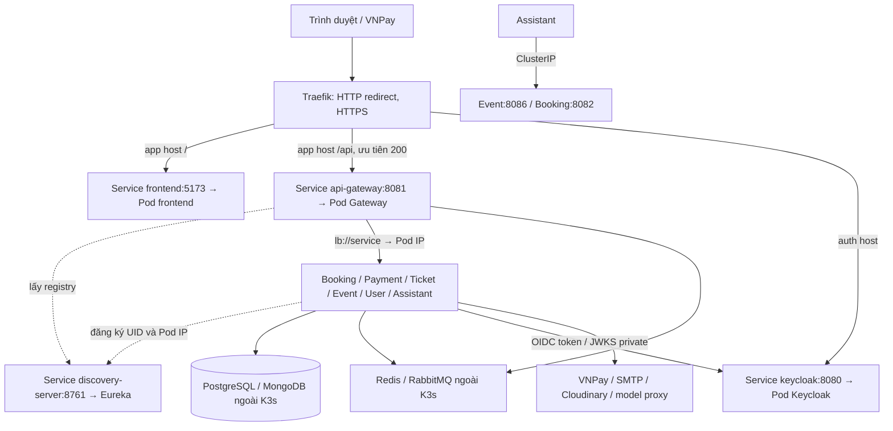

# Phân tích kiến trúc Kubernetes hiện tại

Ngày đọc source: 20/11/2026. Phạm vi: `deploy/k8s`, `deploy/k3s`, `deploy/https`, script triển khai, registry/workflow CD và cấu hình ứng dụng liên quan. Đây là phân tích source; chưa truy cập cluster, SSH hay xác minh cutover production. Không thay đổi cấu hình triển khai.

## 1. Kiến trúc tổng thể

Hệ thống dùng **K3s cho tầng ứng dụng, kết hợp hạ tầng dữ liệu ngoài cluster**. Config mẫu định nghĩa server `ft84`, IP private `172.31.41.236`, Flannel VXLAN, Pod CIDR `10.42.0.0/16`, Service CIDR `10.43.0.0/16`, bật secrets encryption. Có template thêm worker; không có bằng chứng runtime nhiều node trong lượt kiểm tra này.

Sơ đồ mô tả routing trong manifest mới. Backend IP private của Keycloak vẫn là `172.31.41.236:8080`; manifest giữ hostPort này để tương thích client nội bộ. Không thể từ sơ đồ kết luận cutover đã xảy ra.

## 2. Thành phần và trách nhiệm

Tất cả workload ứng dụng ở namespace `flash-ticket`. `.github/services.json` hiện khai báo **10 app runtime k8s**.

| Thành phần | Controller / port | Scale trong source | Vai trò |
|---|---|---|---|
| Frontend | Deployment / 5173 | 1, không HPA | SPA; VITE cấu hình lúc build |
| API Gateway | Deployment / 8081 | 1, không HPA | Route, JWT, Redis rate limit, circuit breaker |
| Eureka | StatefulSet / 8761 | 1 | Registry; Service client và headless DNS |
| Booking | Deployment / 8082 | HPA 1–2 | Đơn và availability; PostgreSQL, Redis, RabbitMQ |
| Payment | Deployment / 8083 | HPA 1–2 | Thanh toán, callback VNPay; PostgreSQL, RabbitMQ |
| Ticket | Deployment / 8084 | HPA 1–2 | Vé, QR, delivery; PostgreSQL, RabbitMQ, SMTP |
| User | Deployment / 8085 | HPA 1–2 | Hồ sơ/identity; MongoDB, RabbitMQ, Keycloak |
| Event | Deployment / 8086 | HPA 1–2 | Sự kiện, read model; PostgreSQL, RabbitMQ |
| Assistant | Deployment / 8089 | 1, không HPA | Redis, model proxy, Event/Booking qua ClusterIP |
| Keycloak | Deployment / 8080 | 1, Recreate | OIDC; cố định ft84, hostPort và theme hostPath |

StatefulSet Eureka cung cấp tên ổn định; không có PVC trong manifest này. Không nên hiểu StatefulSet là registry bền vững trên đĩa hay là cụm HA. Headless Service còn tên `peers` nhưng StatefulSet hiện chỉ có một replica.

## 3. Networking và discovery

Traefik route `/api` tới Gateway với priority 200, cao hơn frontend `/` priority 100. Auth có host riêng. API Gateway tắt discovery locator tự động và khai báo route cụ thể `lb://...`, tránh tự public mọi service được đăng ký.

Đường nghiệp vụ chủ yếu: **Gateway → Spring Cloud LoadBalancer → địa chỉ Pod từ Eureka**, thay vì Service Kubernetes cho từng backend. Event và Booking có thêm ClusterIP để Assistant gọi trực tiếp. Vì vậy hệ thống có hai cơ chế tìm địa chỉ cùng tồn tại.

Hệ quả: EndpointSlice readiness của Kubernetes không trực tiếp loại Pod khỏi đường gọi qua Eureka. Việc đăng ký, rút khỏi registry và độ trễ cache phía client là một phần của tính đúng khi rollout. Source dùng UID làm instance ID, Pod IP qua Downward API, fetch interval 5 giây cho Gateway/core và tắt cache LoadBalancer ở các ConfigMap đó.

Dữ liệu nằm ngoài cluster: bốn DB PostgreSQL riêng theo Booking/Payment/Ticket/Event; User dùng Mongo URI từ Secret. Các endpoint PostgreSQL/Redis/RabbitMQ trỏ private IP cố định của ft84. Thêm worker giúp phân tán app nhưng không tự tạo HA hoặc mở rộng tầng dữ liệu.

## 4. Rollout và health

Gateway/core/Assistant dùng RollingUpdate `maxUnavailable: 0`, `maxSurge: 1`, `minReadySeconds: 75`, grace period 180 giây. Startup kiểm health local và đúng instance UID/IP UP trong Eureka; preStop đánh dấu OUT_OF_SERVICE, chờ 75 giây rồi shutdown.

Đây là cơ chế giảm request rơi vào Pod đang dừng. Nó cần headroom cho Pod surge và Pod đang terminate; không bảo đảm không lỗi khi node chết đột ngột. Startup phụ thuộc Eureka khiến rollout mới có thể bị chặn khi registry lỗi, trong khi readiness hiện có chỉ dựa availability state nên tránh đồng loạt loại các Pod đang phục vụ chỉ vì dependency lỗi.

Frontend dùng probe `/index.html`, minReady 10 giây, grace 30 giây. HTTP 200 chưa chứng minh JS/auth hoạt động; các bản frontend khác nhau trong rollout có nguy cơ chunk 404 nếu không giữ assets cũ.

Keycloak dùng Recreate, một replica, ghim ft84 và hostPort 8080. Cập nhật có khoảng gián đoạn; không áp dụng kỳ vọng rolling continuity của các backend cho Keycloak. Theme hostPath cũng cần tồn tại trên đúng node.

## 5. Scale và tài nguyên

Năm HPA dùng CPU target 70% so với requests, min 1/max 2, scale-up tối đa thêm 1 Pod/60 giây, scale-down stabilization 300 giây. HPA không theo queue depth, độ trễ hay số đơn đang chờ. Đây là giới hạn đáng chú ý khi flash sale tạo đột biến hoặc nghẽn do I/O.

Tổng requests của 10 app, giả sử mỗi app một Pod theo manifest: **1125m CPU, 3872Mi RAM (~3,78GiB)**; tổng memory limits **6336Mi (~6,19GiB)**. Chưa gồm Traefik, CoreDNS, metrics, K3s, OS, DB, cache, broker hoặc Pod surge. Nếu cả năm HPA đạt hai replica, requests tăng lên **1775m CPU, 6048Mi RAM (~5,91GiB)**. Tổng này là phép cộng cấu hình, không phải mức sử dụng đo thực tế.

Runbook ghi máy khoảng 2 vCPU/7,6GiB RAM; thông tin đó chưa được đo lại. Nếu vẫn dùng máy này cho cả app và data, headroom khi rollout/scale là vấn đề cần đo trước khi tăng replica. Các app không khai báo CPU limit; vẫn có CPU requests để scheduler/HPA dùng.

## 6. Secret, storage và phát hành

ConfigMap chứa endpoint/cấu hình; Secret được tạo từ danh sách key cho phép trong env template. Ticket mount QR key-ring read-only, cần giữ khóa cũ để đọc vé đã phát hành. Không có PVC DB trong `deploy/k8s`; dữ liệu bền vững thuộc hạ tầng ngoài cluster. Riêng Traefik cấu hình persistence local-path 128Mi để giữ ACME state, một replica và Recreate để tránh ghi đồng thời.

Frontend có read-only root filesystem; Gateway/core/Assistant chạy non-root UID 10001, bỏ capabilities và không tự mount service-account token. Không tìm thấy NetworkPolicy, PodDisruptionBudget hoặc topology spread/anti-affinity trong cây deploy đã đọc. Namespace và việc không public Ingress không tự tạo cách ly truy cập giữa các Pod.

CD verify/build/publish GHCR rồi deploy qua SSH bằng script. Manifest có image placeholder nên **không apply đệ quy cả thư mục**. Script kiểm digest/SHA, khóa flock, marker enabled/maintenance; Keycloak cần marker cutover riêng. Revision giữ image, manifest và Secret snapshot; rollout lỗi thử khôi phục revision trước và vẫn trả failure. Đây là triển khai YAML + script điều phối, chưa thấy mô hình GitOps reconcile liên tục.

Health, rollout và registry check chưa thay cho kiểm tra nghiệp vụ: token, đặt đơn, callback, phát vé và consumer khi hai replica cần kiểm riêng. Báo cáo này không chạy mutation/test giao dịch lên production.

## 7. Điểm cần xử lý theo mức ưu tiên

1. **Thống nhất trạng thái source/runtime.** Registry CD đã chuyển cả 10 app sang K8s; README K8s vẫn nói 8 app, Keycloak Compose và frontend chưa cutover. `external-services.yaml` còn ghi Keycloak Compose trong khi Ingress mới trỏ Service keycloak. Đối chiếu live Deployment/Ingress/current digest/marker rồi cập nhật docs theo kết quả; không apply các file để thử suy đoán trạng thái.
2. **Đo headroom và giới hạn failure domain.** Một server K3s, endpoint data cùng host, Gateway/Eureka/Traefik/Keycloak đơn lẻ tạo nhiều điểm lỗi tập trung. Thêm worker không khắc phục control plane/data trên ft84. Chọn mục tiêu availability và ngân sách trước khi nâng topology.
3. **Kiểm khả năng scale nghiệp vụ.** Giới hạn max 2 và tín hiệu CPU có thể phản ứng chậm với flash sale. Đo CPU/RAM/latency/queue/DB pool, xác minh idempotency và worker locking với hai replica trước khi tăng trần hoặc đổi tín hiệu HPA.
4. **Kiểm discovery khi drain/failure.** Đo request lỗi trong rollout, node failure và registry outage. Khi cần đơn giản hóa, đánh giá chuyển dần HTTP nội bộ sang Service DNS; cần thay đổi client/discovery/probe/drain cùng nhau.
5. **Tăng cách ly và khả năng phục hồi.** Thiết kế NetworkPolicy theo luồng thật, kiểm backup/restore data, QR key-ring và ACME. Nếu có nhiều node và replica, bổ sung topology/PDB phù hợp; một PDB không thay thế replica dự phòng.
6. **Giảm phụ thuộc host của Keycloak.** Theme hostPath, nodeSelector và hostPort giữ tương thích lúc chuyển nhưng hạn chế reschedule. Đánh giá đóng gói theme vào image và dùng DNS nội bộ khi đã có kế hoạch chuyển endpoint an toàn.

## Nguồn đối chiếu chính

- `deploy/k3s/{README.md,server-config.yaml.example,agent-config.yaml.example}`
- `deploy/k8s/*/{deployment.yaml,statefulset.yaml,configmap.yaml,service.yaml,hpa.yaml}` (tùy thành phần)
- `deploy/https/{ingress.yaml,external-services.yaml,traefik-config.yaml}`
- `.github/services.json`, `.github/workflows/_deploy-service.yml`
- `deploy/scripts/{deploy-k8s-service.sh,migrate-k8s-discovery.py}`
- `infrastructure/api-gateway/src/main/resources/application.yaml`
- `services/{user-service,ticket-service,assistant-service}/src/main/resources/application.yaml`

Không sử dụng giá trị credential thật. Các thay đổi frontend có sẵn trong workspace được giữ nguyên.
