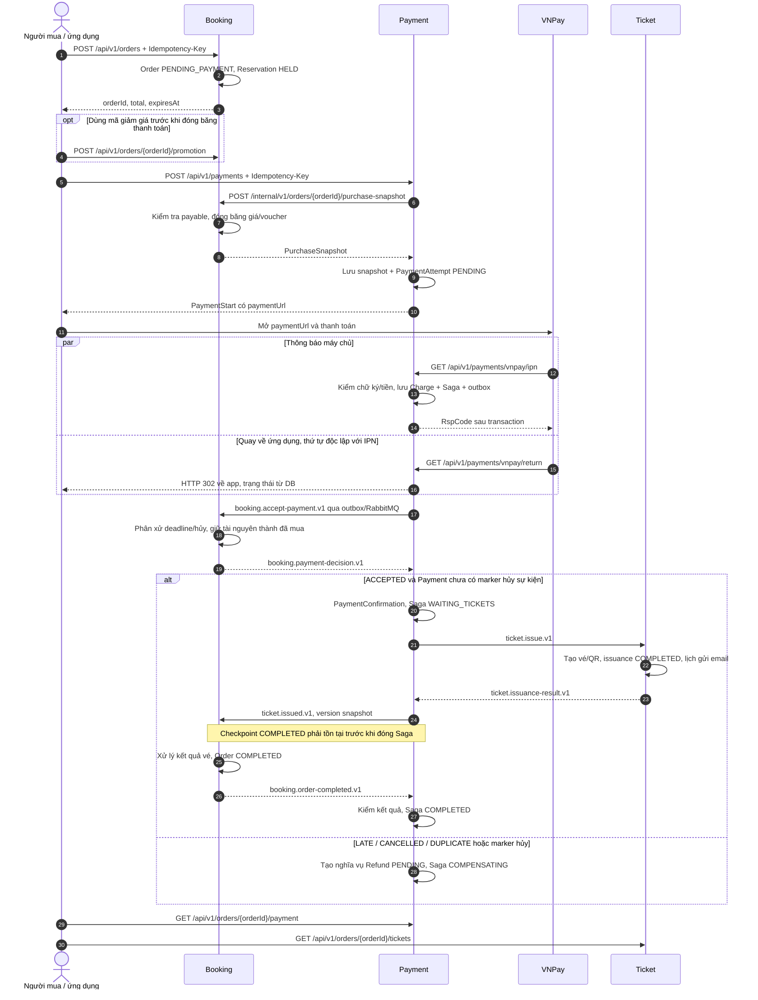

# Luồng thanh toán từ đầu đến cuối — Flash Ticket

Đối chiếu source ngày 02/11/2026, nhánh `dev/tuan`, gồm thay đổi chưa commit. Phạm vi: tạo đơn/giữ vé → VNPay → Booking chấp nhận tiền → phát vé → hoàn tất đơn; kèm lỗi, retry và nghĩa vụ hoàn tiền. Mô tả phía backend; thao tác ứng dụng dưới đây là cách gọi các API đã có, chưa xác minh frontend.

**Ba mốc riêng biệt:** `PaymentAttempt.SUCCEEDED` = VNPay báo thu tiền; `PaymentConfirmation` = khoản tiền được chấp nhận; `Order.COMPLETED` và `PaymentSaga.COMPLETED` = hoàn tất quy trình.

## 1. Sơ đồ tổng thể

Các mũi tên mô tả code đã đồng bộ trong worktree Payment ngày 02/11/2026; definitions chưa áp lên broker119. Xem mục 5 về kiểm chứng và giới hạn triển khai.



## 2. Từ chọn vé đến mở VNPay

| Bước | Xử lý thực tế | Source |
| --- | --- | --- |
| Tạo đơn | Kiểm người mua, key chống lặp, sự kiện đang bán, hạn mức và tài nguyên. Tạo `PENDING_PAYMENT`, reservation `HELD`, đặt `expiresAt`; hỗ trợ số lượng, khu đứng và ghế chỉ định. | [createOrder](<D:/DATN/flash-ticket-platform/services/booking-service/src/main/java/com/flashticket/booking_service/order/service/impl/OrderServiceImpl.java>) |
| Xin thanh toán | API yêu cầu role BUYER, JWT và header UUID `Idempotency-Key`. Request truyền `orderId`; tiền lấy từ Booking. | [PaymentController](<D:/DATN/payment-snapshot-version/services/payment-service/src/main/java/com/flashticket/payment_service/controller/PaymentController.java>) |
| Chốt số tiền | Booking khóa dữ liệu, yêu cầu đơn `PENDING_PAYMENT`, reservation `HELD`, chưa hết hạn và sự kiện chưa hủy. Lưu `frozenPurchaseSnapshot`; lần sau trả lại snapshot đã chốt nếu dữ liệu còn nhất quán. | [preparePurchaseSnapshot](<D:/DATN/flash-ticket-platform/services/booking-service/src/main/java/com/flashticket/booking_service/order/service/impl/OrderServiceImpl.java>) |
| Tạo attempt | Payment gọi HTTP Booking trước, rồi mới mở transaction Payment. Kiểm owner, hạn, VND, hash snapshot và các attempt cũ. Lưu `OrderPaymentSnapshot` + attempt `PENDING`. | [createPayment / savePaymentAttempt](<D:/DATN/payment-snapshot-version/services/payment-service/src/main/java/com/flashticket/payment_service/service/PaymentService.java>) |
| Tạo URL | `vnp_TxnRef = attemptId`; `vnp_Amount = expectedAmount × 100`; hạn URL là mốc sớm hơn giữa hạn đơn và 15 phút. Sắp xếp tham số và ký HMAC-SHA512. | [buildVNPayUrl](<D:/DATN/payment-snapshot-version/services/payment-service/src/main/java/com/flashticket/payment_service/service/PaymentService.java>) |

Ví dụ request (thay UUID/token bằng dữ liệu thật):

```http
POST /api/v1/payments
Authorization: Bearer <access-token>
Idempotency-Key: <uuid-của-yêu-cầu>
Content-Type: application/json

{"orderId":"<uuid-của-đơn>"}
```

Đoạn quyết định về retry:

```java
if (storedAttempt != null) {
  if (!requestHash.equals(storedAttempt.getRequestHash()))
    throw new PaymentException(PaymentErrorCode.IDEMPOTENCY_CONFLICT);
  if (storedAttempt.getState() == PaymentAttemptState.UNKNOWN)
    throw new PaymentException(PaymentErrorCode.PAYMENT_IN_PROGRESS);
  return starts.toDto(storedAttempt, incomingPurchase.expiresAt());
}
```

Cùng key trả attempt cũ nếu vượt qua các kiểm tra trước đó; không tự mở lần trả tiền khác. Key mới bị chặn khi còn attempt chưa kết thúc hoặc lần gần nhất đã thành công. Sau FAILED có thể tạo attempt mới nếu Booking vẫn cho thanh toán. Sau khi có confirmation, yêu cầu khởi tạo bị chặn trước nhánh replay.

**Khác Shop App:** so với `OrderService.createOrder` trong snapshot 19 file đi kèm skill, luồng này thêm snapshot bất biến, khóa và idempotency giữa các service. HTTP Booking và transaction Payment là hai phạm vi riêng; không có transaction chung cho hai DB.

## 3. VNPay trả kết quả: IPN và Return có vai trò riêng

[handleIPN](<D:/DATN/payment-snapshot-version/services/payment-service/src/main/java/com/flashticket/payment_service/service/PaymentService.java>) kiểm lần lượt chữ ký → attempt → merchant → số tiền → mã kết quả; thành công còn yêu cầu transaction number và ngày trả tiền hợp lệ.

```java
boolean success = "00".equals(responseCode) && "00".equals(transactionStatus);
boolean failed =
    "02".equals(transactionStatus) && !"00".equals(responseCode) && !"07".equals(responseCode);
```

- Thành công: lưu `Charge`, khởi tạo Saga `WAITING_BOOKING` và outbox `booking.accept-payment.v1` trong cùng transaction; attempt thành `SUCCEEDED`.
- Thất bại theo điều kiện trên: attempt thành `FAILED`, có `finishedAt`.
- Kết quả còn chưa chắc chắn: `UNKNOWN`, để `finishedAt = null`; chặn lần trả tiền mới.
- Callback trùng provider/merchant/transaction number trả `RspCode=02`; callback không thành công đến muộn không hạ trạng thái SUCCEEDED/FAILED.
- Chữ ký/merchant sai trả 97; không tìm thấy attempt trả 01; tiền sai trả 04; dữ liệu kết quả/giao dịch/ngày không hợp lệ trả 99.
- `RspCode=00` là xác nhận đã xử lý IPN, có thể đi kèm attempt FAILED/UNKNOWN; không có nghĩa đơn đã hoàn tất.

[handleReturn / buildAppReturnUri](<D:/DATN/payment-snapshot-version/services/payment-service/src/main/java/com/flashticket/payment_service/service/PaymentService.java>) chỉ xác minh và đọc DB, rồi controller trả HTTP 302 về app. Return không cập nhật thanh toán. Nếu Return đến trước IPN, app có thể thấy PENDING và cần đọc lại API trạng thái. Nếu xác minh Return lỗi, deep link có `status=FAILED`; đây không phải thao tác đổi attempt trong DB.

## 4. Từ nhận tiền đến hoàn tất đơn

1. [recordSuccessfulCharge](<D:/DATN/payment-snapshot-version/services/payment-service/src/main/java/com/flashticket/payment_service/service/impl/PaymentSagaServiceImpl.java>) chọn charge đầu cho Saga; charge khác của cùng đơn được ghi nghĩa vụ hoàn do thanh toán thừa.
2. [Booking.acceptPayment](<D:/DATN/flash-ticket-platform/services/booking-service/src/main/java/com/flashticket/booking_service/order/service/impl/OrderServiceImpl.java>) khóa dữ liệu và kiểm snapshot. Cùng charge đã nhận trả ACCEPTED; charge khác trả DUPLICATE.
3. [settlePendingPayment](<D:/DATN/flash-ticket-platform/services/booking-service/src/main/java/com/flashticket/booking_service/order/service/impl/OrderServiceImpl.java>) đọc giờ DB **sau khi chờ các khóa**. Nếu trước deadline và chưa hủy: reservation HELD → COMMITTED, counter held → purchased, đơn → ISSUING. Nếu trễ/hủy: giải phóng phần còn HELD, trả LATE/CANCELLED. Thời điểm VNPay trừ tiền không thay thế mốc phân xử này.
4. [recordPaymentDecision](<D:/DATN/payment-snapshot-version/services/payment-service/src/main/java/com/flashticket/payment_service/service/impl/PaymentSagaServiceImpl.java>) nhận ACCEPTED và chưa có marker hủy thì lưu confirmation, chuyển WAITING_TICKETS và gửi `ticket.issue.v1`; nhánh còn lại tạo refund và COMPENSATING.
5. [TicketService.issue](https://github.com/levanminh04/flash-ticket-platform/blob/4c328fd8c78e503cf9cdbd1d0a464a24c2413c71/services/ticket-service/src/main/java/com/flashticket/ticket_service/application/TicketService.java) kiểm cấu hình sự kiện, chống phát trùng theo order/hash; tạo vé VALID, QR và lịch gửi email; issuance, inbox và result outbox commit cùng transaction. Thiếu access configuration là lỗi chờ xử lý lại; sự kiện đã hủy cho terminal FAILED. Không dùng `IssuanceServiceImpl` scaffold để mô tả bước phát vé.
6. [recordIssuanceResult](<D:/DATN/payment-snapshot-version/services/payment-service/src/main/java/com/flashticket/payment_service/service/impl/PaymentSagaServiceImpl.java>) kiểm charge và số vé, lưu kết quả thông báo Booking. Nhận COMPLETED vẫn giữ WAITING_TICKETS. FAILED tạo refund và báo Booking; marker hủy chuyển sang bù trừ.
7. [processBookingIssuanceResult](<D:/DATN/flash-ticket-platform/services/booking-service/src/main/java/com/flashticket/booking_service/order/service/impl/OrderServiceImpl.java>) có logic hoàn tất đơn và phát `booking.order-completed.v1`; lỗi phát vé thì trả tài nguyên đã purchased/used, đơn thành ISSUANCE_FAILED hoặc CANCELLED. Payment gửi ticket.issued.v1 / booking.issuance-failed.v1 với version snapshot; definitions phải được áp riêng khi deploy.
8. [recordOrderCompleted](<D:/DATN/payment-snapshot-version/services/payment-service/src/main/java/com/flashticket/payment_service/service/impl/PaymentSagaServiceImpl.java>) kiểm charge, issuanceId, số vé và checkpoint kết quả đã gửi; chỉ chuyển Saga COMPLETED khi hợp lệ, chưa bù trừ và không có marker hủy.

**Khác Shop App:** đây là Saga nhiều transaction cục bộ, có inbox/outbox và RabbitMQ. Lưu DB không đồng nghĩa broker đã nhận; broker ACK không đồng nghĩa Booking/Ticket đã xử lý. Payment listener ACK sau service commit. [PaymentWorker](<D:/DATN/payment-snapshot-version/services/payment-service/src/main/java/com/flashticket/payment_service/worker/PaymentWorker.java>) gửi outbox với confirm/return và retry; recovery gửi lại bước đang chờ, không coi timeout là phát vé thất bại.

## 5. Contract đã đồng bộ và giới hạn runtime

| Điểm | Hành vi code mới |
| --- | --- |
| Ticket→Payment | ticket.issuance-result.v1 vào payment.ticket-issuance-failed.q; definitions đã sửa, chưa xác nhận binding119 đã đổi |
| Payment→Booking | COMPLETED→ticket.issued.v1; FAILED→booking.issuance-failed.v1; cùng DTO BookingIssuanceResult |
| Version gửi Booking | Lấy source_order_version từ snapshot Payment, không lấy rowVersion Saga |
| Checkpoint | OrderCompleted phải khớp COMPLETED đã lưu; không cho bypass Ticket→Payment; reply không cần chờ publishedAt |
| Recovery | Có result thì gửi lại result, không phát vé lần hai; chưa result thì retry command cũ, giữ version command |
| Legacy | Chỉ nhận diện result cũ trong lịch sử để recovery đúng key; pending/DLQ cần xử lý được duyệt trước rollout |
| Runtime Ticket | Cần bật business/listeners/workers và có access event/QR key ring; chưa được xác nhận bằng E2E lượt này |
| Refund | ensureRefund vẫn chỉ ghi nghĩa vụ PENDING; không có triển khai hủy/refund provider mới |

**Khác Shop App:** checkpoint/inbox/outbox và transaction/ACK hiện có bảo vệ replay/rollback giữa các service; không có transaction DB bao trùm HTTP/broker. Query IN tìm cả hai outcome và so conflict trước state early-return. Không thêm class/helper/framework.

## 6. Các nhánh lỗi cần hiểu khi đọc luồng

| Tình huống | Kết quả |
| --- | --- |
| Chưa thu tiền, đơn hết hạn hoặc bị hủy | Không cho tạo thanh toán mới. Booking có xử lý giải phóng reservation; timestamp tự nó không thực thi worker. |
| IPN thành công nhưng Booking xử lý sau hạn | Vẫn ghi Charge; Booking trả LATE; Payment tạo Refund PENDING, Saga COMPENSATING. |
| Thu tiền thêm cho đơn đã có Saga | Tạo nghĩa vụ DUPLICATE_PAYMENT cho charge thừa; không thay charge chính. |
| Ticket trả terminal FAILED | Tạo nghĩa vụ TICKET_ISSUANCE_FAILED; nhánh Booking có logic trả tài nguyên khi nhận đúng hợp đồng. |
| Payment thấy event cancellation marker | Chặn bước phát hành/hoàn tất mới theo các nhánh Saga; tạo nghĩa vụ EVENT_CANCELLED. Không suy từ đây rằng mọi consumer hủy đã được triển khai. |
| HTTP/broker/worker lỗi tạm thời | Có rollback, outbox retry hoặc Saga recovery tùy bước; không tự suy thành thanh toán FAILED hay hoàn tiền thành công. |

API [getPayment](<D:/DATN/payment-snapshot-version/services/payment-service/src/main/java/com/flashticket/payment_service/service/PaymentService.java>) trả confirmation chargeId, latest attempt, trạng thái start request nếu truyền requestId và danh sách refunds; kiểm quyền chủ đơn. Nó không trả trực tiếp lifecycle đơn hoặc Saga state. API vé nằm ở [TicketApiController](https://github.com/levanminh04/flash-ticket-platform/blob/4c328fd8c78e503cf9cdbd1d0a464a24c2413c71/services/ticket-service/src/main/java/com/flashticket/ticket_service/web/TicketApiController.java).

## 7. Phạm vi kiểm chứng

Java21, env-file gốc, DB/Rabbit local cô lập: 123 test mặc định + 11 integration test Payment pass; Spotless đạt, SpotBugs0. U1/U2 tái hiện thiếu checkpoint/kết quả mâu thuẫn trên code cũ và pass sau sửa. Sáu fixture snapshot và hai result envelope được kiểm codec/validator thật; result fixture dựng theo serializer/payload Ticket chứ chưa phát từ transaction Ticket thật.

Chưa chạy E2E HTTP→ba service→DB/broker hoặc giao dịch VNPay sandbox, chưa đổi119, chưa push/deploy. Local thiếu bộ OAuth Payment và QR key ring/active key Ticket; không tự lấy credential runtime119 hoặc coi test wire là E2E. Hủy event/refund provider mới vẫn ngoài scope.
