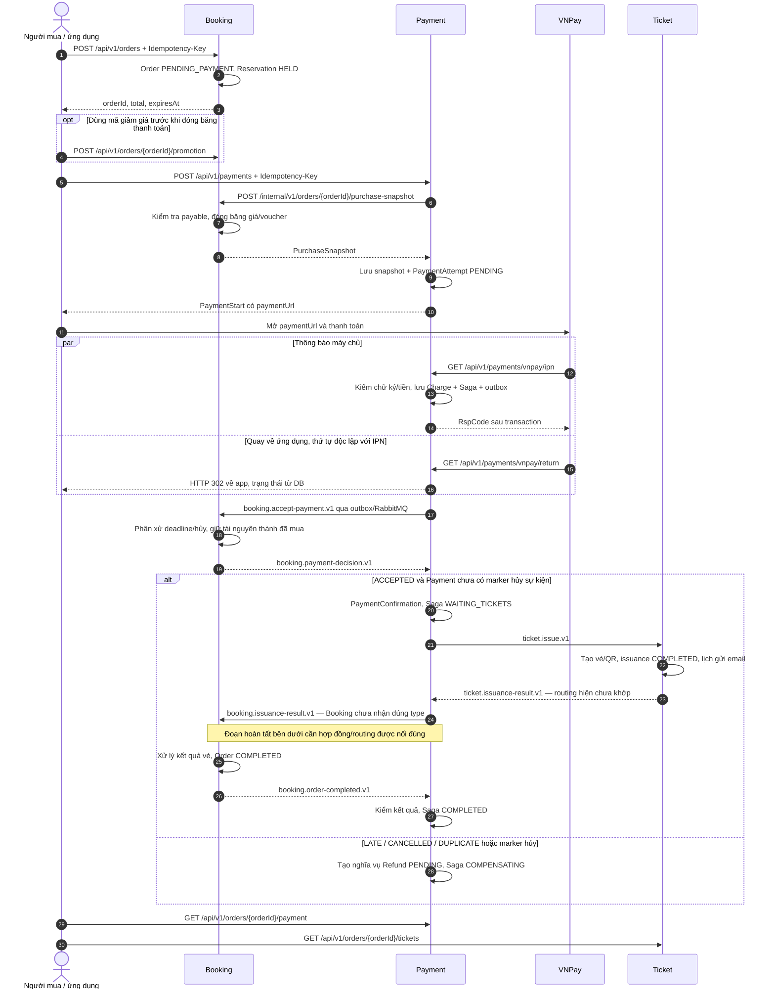

# Luồng thanh toán từ đầu đến cuối — Flash Ticket

Đối chiếu source ngày 02/11/2026, nhánh `dev/tuan`, gồm thay đổi chưa commit. Phạm vi: tạo đơn/giữ vé → VNPay → Booking chấp nhận tiền → phát vé → hoàn tất đơn; kèm lỗi, retry và nghĩa vụ hoàn tiền. Mô tả phía backend; thao tác ứng dụng dưới đây là cách gọi các API đã có, chưa xác minh frontend.

**Ba mốc riêng biệt:** `PaymentAttempt.SUCCEEDED` = VNPay báo thu tiền; `PaymentConfirmation` = khoản tiền được chấp nhận; `Order.COMPLETED` và `PaymentSaga.COMPLETED` = hoàn tất quy trình.

## 1. Sơ đồ tổng thể

Các mũi tên message biểu diễn logic gửi/nhận trong code. Hai đoạn có ghi “chưa khớp” đang khác hợp đồng hoặc routing giữa các thành phần; xem mục 5.



## 2. Từ chọn vé đến mở VNPay

| Bước | Xử lý thực tế | Source |
| --- | --- | --- |
| Tạo đơn | Kiểm người mua, key chống lặp, sự kiện đang bán, hạn mức và tài nguyên. Tạo `PENDING_PAYMENT`, reservation `HELD`, đặt `expiresAt`; hỗ trợ số lượng, khu đứng và ghế chỉ định. | [createOrder](<C:/Users/WEOHWOEH/Documents/DATN 2026/Docs/flash-ticket-platform/services/booking-service/src/main/java/com/flashticket/booking_service/order/service/impl/OrderServiceImpl.java:1358>) |
| Xin thanh toán | API yêu cầu role BUYER, JWT và header UUID `Idempotency-Key`. Request truyền `orderId`; tiền lấy từ Booking. | [PaymentController](<C:/Users/WEOHWOEH/Documents/DATN 2026/Docs/flash-ticket-platform/services/payment-service/src/main/java/com/flashticket/payment_service/controller/PaymentController.java:37>) |
| Chốt số tiền | Booking khóa dữ liệu, yêu cầu đơn `PENDING_PAYMENT`, reservation `HELD`, chưa hết hạn và sự kiện chưa hủy. Lưu `frozenPurchaseSnapshot`; lần sau trả lại snapshot đã chốt nếu dữ liệu còn nhất quán. | [preparePurchaseSnapshot](<C:/Users/WEOHWOEH/Documents/DATN 2026/Docs/flash-ticket-platform/services/booking-service/src/main/java/com/flashticket/booking_service/order/service/impl/OrderServiceImpl.java:1200>) |
| Tạo attempt | Payment gọi HTTP Booking trước, rồi mới mở transaction Payment. Kiểm owner, hạn, VND, hash snapshot và các attempt cũ. Lưu `OrderPaymentSnapshot` + attempt `PENDING`. | [createPayment / savePaymentAttempt](<C:/Users/WEOHWOEH/Documents/DATN 2026/Docs/flash-ticket-platform/services/payment-service/src/main/java/com/flashticket/payment_service/service/PaymentService.java:68>) |
| Tạo URL | `vnp_TxnRef = attemptId`; `vnp_Amount = expectedAmount × 100`; hạn URL là mốc sớm hơn giữa hạn đơn và 15 phút. Sắp xếp tham số và ký HMAC-SHA512. | [buildVNPayUrl](<C:/Users/WEOHWOEH/Documents/DATN 2026/Docs/flash-ticket-platform/services/payment-service/src/main/java/com/flashticket/payment_service/service/PaymentService.java:277>) |

Ví dụ request (thay UUID/token bằng dữ liệu thật):

```http
POST /api/v1/payments
Authorization: Bearer <access-token>
Idempotency-Key: <uuid-của-yêu-cầu>
Content-Type: application/json

{"orderId":"<uuid-của-đơn>"}
```

Đoạn quyết định về retry:

```java
if (storedAttempt != null) {
  if (!requestHash.equals(storedAttempt.getRequestHash()))
    throw new PaymentException(PaymentErrorCode.IDEMPOTENCY_CONFLICT);
  if (storedAttempt.getState() == PaymentAttemptState.UNKNOWN)
    throw new PaymentException(PaymentErrorCode.PAYMENT_IN_PROGRESS);
  return starts.toDto(storedAttempt, incomingPurchase.expiresAt());
}
```

Cùng key trả attempt cũ nếu vượt qua các kiểm tra trước đó; không tự mở lần trả tiền khác. Key mới bị chặn khi còn attempt chưa kết thúc hoặc lần gần nhất đã thành công. Sau FAILED có thể tạo attempt mới nếu Booking vẫn cho thanh toán. Sau khi có confirmation, yêu cầu khởi tạo bị chặn trước nhánh replay.

**Khác Shop App:** so với `OrderService.createOrder` trong snapshot 19 file đi kèm skill, luồng này thêm snapshot bất biến, khóa và idempotency giữa các service. HTTP Booking và transaction Payment là hai phạm vi riêng; không có transaction chung cho hai DB.

## 3. VNPay trả kết quả: IPN và Return có vai trò riêng

[handleIPN](<C:/Users/WEOHWOEH/Documents/DATN 2026/Docs/flash-ticket-platform/services/payment-service/src/main/java/com/flashticket/payment_service/service/PaymentService.java:146>) kiểm lần lượt chữ ký → attempt → merchant → số tiền → mã kết quả; thành công còn yêu cầu transaction number và ngày trả tiền hợp lệ.

```java
boolean success = "00".equals(responseCode) && "00".equals(transactionStatus);
boolean failed =
    "02".equals(transactionStatus) && !"00".equals(responseCode) && !"07".equals(responseCode);
```

- Thành công: lưu `Charge`, khởi tạo Saga `WAITING_BOOKING` và outbox `booking.accept-payment.v1` trong cùng transaction; attempt thành `SUCCEEDED`.
- Thất bại theo điều kiện trên: attempt thành `FAILED`, có `finishedAt`.
- Kết quả còn chưa chắc chắn: `UNKNOWN`, để `finishedAt = null`; chặn lần trả tiền mới.
- Callback trùng provider/merchant/transaction number trả `RspCode=02`; callback không thành công đến muộn không hạ trạng thái SUCCEEDED/FAILED.
- Chữ ký/merchant sai trả 97; không tìm thấy attempt trả 01; tiền sai trả 04; dữ liệu kết quả/giao dịch/ngày không hợp lệ trả 99.
- `RspCode=00` là xác nhận đã xử lý IPN, có thể đi kèm attempt FAILED/UNKNOWN; không có nghĩa đơn đã hoàn tất.

[handleReturn / buildAppReturnUri](<C:/Users/WEOHWOEH/Documents/DATN 2026/Docs/flash-ticket-platform/services/payment-service/src/main/java/com/flashticket/payment_service/service/PaymentService.java:229>) chỉ xác minh và đọc DB, rồi controller trả HTTP 302 về app. Return không cập nhật thanh toán. Nếu Return đến trước IPN, app có thể thấy PENDING và cần đọc lại API trạng thái. Nếu xác minh Return lỗi, deep link có `status=FAILED`; đây không phải thao tác đổi attempt trong DB.

## 4. Từ nhận tiền đến hoàn tất đơn

1. [recordSuccessfulCharge](<C:/Users/WEOHWOEH/Documents/DATN 2026/Docs/flash-ticket-platform/services/payment-service/src/main/java/com/flashticket/payment_service/service/impl/PaymentSagaServiceImpl.java:39>) chọn charge đầu cho Saga; charge khác của cùng đơn được ghi nghĩa vụ hoàn do thanh toán thừa.
2. [Booking.acceptPayment](<C:/Users/WEOHWOEH/Documents/DATN 2026/Docs/flash-ticket-platform/services/booking-service/src/main/java/com/flashticket/booking_service/order/service/impl/OrderServiceImpl.java:750>) khóa dữ liệu và kiểm snapshot. Cùng charge đã nhận trả ACCEPTED; charge khác trả DUPLICATE.
3. [settlePendingPayment](<C:/Users/WEOHWOEH/Documents/DATN 2026/Docs/flash-ticket-platform/services/booking-service/src/main/java/com/flashticket/booking_service/order/service/impl/OrderServiceImpl.java:973>) đọc giờ DB **sau khi chờ các khóa**. Nếu trước deadline và chưa hủy: reservation HELD → COMMITTED, counter held → purchased, đơn → ISSUING. Nếu trễ/hủy: giải phóng phần còn HELD, trả LATE/CANCELLED. Thời điểm VNPay trừ tiền không thay thế mốc phân xử này.
4. [recordPaymentDecision](<C:/Users/WEOHWOEH/Documents/DATN 2026/Docs/flash-ticket-platform/services/payment-service/src/main/java/com/flashticket/payment_service/service/impl/PaymentSagaServiceImpl.java:74>) nhận ACCEPTED và chưa có marker hủy thì lưu confirmation, chuyển WAITING_TICKETS và gửi `ticket.issue.v1`; nhánh còn lại tạo refund và COMPENSATING.
5. [TicketService.issue](<C:/Users/WEOHWOEH/Documents/DATN 2026/Docs/flash-ticket-platform/services/ticket-service/src/main/java/com/flashticket/ticket_service/application/TicketService.java:190>) kiểm cấu hình sự kiện, chống phát trùng theo order/hash; tạo vé VALID, QR và lịch gửi email; issuance, inbox và result outbox commit cùng transaction. Thiếu access configuration là lỗi chờ xử lý lại; sự kiện đã hủy cho terminal FAILED. Không dùng `IssuanceServiceImpl` scaffold để mô tả bước phát vé.
6. [recordIssuanceResult](<C:/Users/WEOHWOEH/Documents/DATN 2026/Docs/flash-ticket-platform/services/payment-service/src/main/java/com/flashticket/payment_service/service/impl/PaymentSagaServiceImpl.java:123>) kiểm charge và số vé, lưu kết quả thông báo Booking. Nhận COMPLETED vẫn giữ WAITING_TICKETS. FAILED tạo refund và báo Booking; marker hủy chuyển sang bù trừ.
7. [processBookingIssuanceResult](<C:/Users/WEOHWOEH/Documents/DATN 2026/Docs/flash-ticket-platform/services/booking-service/src/main/java/com/flashticket/booking_service/order/service/impl/OrderServiceImpl.java:380>) có logic hoàn tất đơn và phát `booking.order-completed.v1`; lỗi phát vé thì trả tài nguyên đã purchased/used, đơn thành ISSUANCE_FAILED hoặc CANCELLED. **Hiện message đầu vào bước này chưa khớp Payment, xem mục 5.**
8. [recordOrderCompleted](<C:/Users/WEOHWOEH/Documents/DATN 2026/Docs/flash-ticket-platform/services/payment-service/src/main/java/com/flashticket/payment_service/service/impl/PaymentSagaServiceImpl.java:199>) kiểm charge, issuanceId, số vé và checkpoint kết quả đã gửi; chỉ chuyển Saga COMPLETED khi hợp lệ, chưa bù trừ và không có marker hủy.

**Khác Shop App:** đây là Saga nhiều transaction cục bộ, có inbox/outbox và RabbitMQ. Lưu DB không đồng nghĩa broker đã nhận; broker ACK không đồng nghĩa Booking/Ticket đã xử lý. Payment listener ACK sau service commit. [PaymentWorker](<C:/Users/WEOHWOEH/Documents/DATN 2026/Docs/flash-ticket-platform/services/payment-service/src/main/java/com/flashticket/payment_service/worker/PaymentWorker.java:46>) gửi outbox với confirm/return và retry; recovery gửi lại bước đang chờ, không coi timeout là phát vé thất bại.

## 5. Những chỗ hiện chưa nối thông từ đầu đến cuối

| Điểm | Bằng chứng trong code/cấu hình | Hệ quả theo cấu hình trong repo |
| --- | --- | --- |
| Ticket → Payment khác routing | Ticket phát `ticket.issuance-result.v1`; [definitions.json](<C:/Users/WEOHWOEH/Documents/DATN 2026/Docs/flash-ticket-platform/deploy/rabbitmq/definitions.json:1>) gắn queue `payment.ticket-issuance-failed.q` với `ticket.issuance-failed.v1`. | Kết quả phát vé không được route vào queue Payment mặc định qua binding đã khai báo. |
| Payment → Booking khác message type | Payment phát `booking.issuance-result.v1`; [BookingIssuanceResultListener](<C:/Users/WEOHWOEH/Documents/DATN 2026/Docs/flash-ticket-platform/services/booking-service/src/main/java/com/flashticket/booking_service/messaging/BookingIssuanceResultListener.java:18>) yêu cầu `ticket.issued.v1` hoặc `booking.issuance-failed.v1`; topology cũng dùng hai key đó. | Không có binding tương ứng cho message Payment; chỉ sửa routing mà giữ type cũ thì listener vẫn reject. |
| Version thông báo kết quả vé khác nghĩa | Payment đặt aggregateVersion theo `saga.rowVersion + 2` tại [envelope gửi Booking](<C:/Users/WEOHWOEH/Documents/DATN 2026/Docs/flash-ticket-platform/services/payment-service/src/main/java/com/flashticket/payment_service/service/impl/PaymentSagaServiceImpl.java:173>); [Booking validator](<C:/Users/WEOHWOEH/Documents/DATN 2026/Docs/flash-ticket-platform/services/booking-service/src/main/java/com/flashticket/booking_service/order/service/impl/OrderServiceImpl.java:446>) yêu cầu bằng `frozen.sourceOrderVersion`. | Cần thống nhất version khi nối hai bên; hiện hai phía không dùng cùng nguồn version. |
| Tính năng Ticket mặc định tắt | [ticket-service.yaml](<C:/Users/WEOHWOEH/Documents/DATN 2026/Docs/flash-ticket-platform/infrastructure/config-server/src/main/resources/config/ticket-service.yaml:71>) mặc định business/listeners/workers là false. | Cần cấu hình bật các tính năng tương ứng khi chạy; tài liệu này không đọc secret hay xác nhận giá trị môi trường runtime. |
| Hoàn tiền mới ghi nghĩa vụ | [ensureRefund](<C:/Users/WEOHWOEH/Documents/DATN 2026/Docs/flash-ticket-platform/services/payment-service/src/main/java/com/flashticket/payment_service/service/impl/RefundServiceImpl.java:27>) chỉ tìm/tạo Refund PENDING. | Không thể coi COMPENSATING/PENDING là đã trả tiền về ngân hàng. |

Đây là đối chiếu tĩnh giữa source và cấu hình khai báo, chưa thử broker đang chạy. Chưa sửa các điểm trên trong lượt viết tài liệu.

## 6. Các nhánh lỗi cần hiểu khi đọc luồng

| Tình huống | Kết quả |
| --- | --- |
| Chưa thu tiền, đơn hết hạn hoặc bị hủy | Không cho tạo thanh toán mới. Booking có xử lý giải phóng reservation; timestamp tự nó không thực thi worker. |
| IPN thành công nhưng Booking xử lý sau hạn | Vẫn ghi Charge; Booking trả LATE; Payment tạo Refund PENDING, Saga COMPENSATING. |
| Thu tiền thêm cho đơn đã có Saga | Tạo nghĩa vụ DUPLICATE_PAYMENT cho charge thừa; không thay charge chính. |
| Ticket trả terminal FAILED | Tạo nghĩa vụ TICKET_ISSUANCE_FAILED; nhánh Booking có logic trả tài nguyên khi nhận đúng hợp đồng. |
| Payment thấy event cancellation marker | Chặn bước phát hành/hoàn tất mới theo các nhánh Saga; tạo nghĩa vụ EVENT_CANCELLED. Không suy từ đây rằng mọi consumer hủy đã được triển khai. |
| HTTP/broker/worker lỗi tạm thời | Có rollback, outbox retry hoặc Saga recovery tùy bước; không tự suy thành thanh toán FAILED hay hoàn tiền thành công. |

API [getPayment](<C:/Users/WEOHWOEH/Documents/DATN 2026/Docs/flash-ticket-platform/services/payment-service/src/main/java/com/flashticket/payment_service/service/PaymentService.java:316>) trả confirmation chargeId, latest attempt, trạng thái start request nếu truyền requestId và danh sách refunds; kiểm quyền chủ đơn. Nó không trả trực tiếp lifecycle đơn hoặc Saga state. API vé nằm ở [TicketApiController](<C:/Users/WEOHWOEH/Documents/DATN 2026/Docs/flash-ticket-platform/services/ticket-service/src/main/java/com/flashticket/ticket_service/web/TicketApiController.java:24>).

## 7. Phạm vi kiểm chứng

Đã đối chiếu implementation Booking/Payment/Ticket và topology RabbitMQ trong repo; các dẫn nguồn chỉ tới checkout hiện tại. Lượt này chỉ tạo tài liệu, kiểm đường dẫn/đoạn trích và diff; không gọi VNPay thật, không chạy giao dịch E2E hay chạy lại test suite. Sơ đồ thể hiện đầy đủ logic đã viết và đánh dấu ranh giới chưa nối thông; không khẳng định hệ thống hiện chạy hoàn tất một giao dịch thật.
